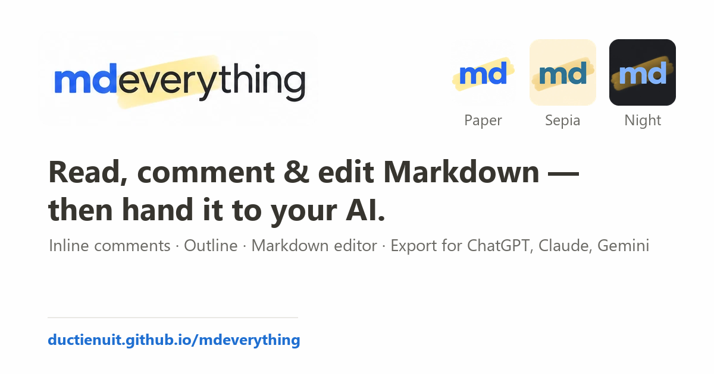

<p align="center"></p>

**Read, comment on and edit Markdown — then hand it to your AI.** mdeverything is a free
web app that runs entirely in your browser: open a Markdown document, leave inline comments
on any passage, tweak the source in a built-in editor, then export a clean, structured
context package for ChatGPT, Claude, Gemini, or your coding assistant.

🔗 **Live app:** https://ductienuit.github.io/mdeverything/ · Tiếng Việt: https://ductienuit.github.io/mdeverything/vi/

> Formerly **Marginalia** (`ductienuit.github.io/marginalia`). The old address now shows a
> short "what's new" page and then brings visitors here.



## What it does

You read a Markdown document inside mdeverything. Select a passage and a comment box opens
right there, Claude-artifact style. Each comment can hold a question or request plus a reply
thread. When you're done, **Export for AI** copies a
structured bundle an assistant can act on:

- the exact **quoted passage**
- its **section location** and a **line hint**
- the **surrounding context** (so duplicate wording is never confused)
- your **comment** and its **replies**

## Features

- **Inline comments** — select text or use the margin button to comment on a whole block;
  hover to preview, click for the card with Edit · Delete · Reply
- **Comments panel** — optional side list of every comment (hidden by default)
- **Outline** — table of contents with scroll-spy; drawer on small screens
- **Markdown editor** — formatting toolbar, shortcuts (Ctrl/Cmd+B · I · K), live preview;
  comments re-anchor after you apply changes
- **Three reading themes** — Paper, Sepia (cream paper + Merriweather), Night
- **Autosave** — your document, comments and preferences stay in your browser between visits
- Renders GitHub-flavored Markdown, wide tables and **Mermaid** diagrams
- Export modes: **full context**, **notes only**, or **raw Markdown**
- Keyboard accessible, responsive from mobile to desktop, `prefers-reduced-motion` aware
- **Multilingual UI** — English and Tiếng Việt, each on its own URL (🌐 language menu in the header);
  the instructions inside the AI export stay in English so every assistant reads them the same way

## Privacy

mdeverything runs **entirely in your browser**. There is no server, no account and no
tracking. Your document and comments never leave your device; they're saved in your
browser's local storage. Third-party libraries (Markdown, sanitizer, diagrams) and fonts are
loaded from public CDNs.

## Use it locally

Nothing to install. Serve the folder: `python -m http.server 8000`, then visit
`http://localhost:8000/` (or `/vi/` for Vietnamese). Opening `index.html` straight from disk also works.

## Editing the app

The pages are **generated**. Edit the sources, then rebuild (Node 18+, no dependencies):

| Edit | What it is |
| --- | --- |
| `src/index.html` | the app template (HTML, CSS, JS). Text is never hard-coded: markup uses `data-i18n="key"`, `data-i18n-attr="title:key;aria-label:key"` or `<!--t:key-->…<!--/t-->`; scripts call `t("key", {n})` |
| `locales/en.json` | every English string (the source of truth); `locales/vi.json` … one file per language |
| `locales/samples/<lang>.md` + `<lang>.annotations.json` | the demo document and its 7 example comments |
| `scripts/locales.mjs` | the list of languages that are built |

```sh
node scripts/build.mjs            # writes index.html, vi/index.html …, sitemap.xml
node scripts/check-locales.mjs    # missing / extra keys, placeholder mismatches, demo quotes
node scripts/test-roundtrip.mjs   # export bundle → sample AI answer → parser, for every language
node scripts/test-backup.mjs      # Markdown backup (.mdeverything.md) → restore: same text, comments and replies
node scripts/build.mjs --check    # fails when a generated file is out of date
```

Commit the generated files together with the sources (GitHub Pages serves the repo root).
Never edit `index.html` or `vi/index.html` by hand: the next build overwrites them.

Message syntax: `"Deleted {name}"`; plurals use a small ICU subset,
`"{n, plural, one {# comment} other {# comments}}"` (categories from `Intl.PluralRules`; `#` is the
number). Keys ending in `_html` may contain markup. Dates and relative times use `Intl`.

### Adding a language

1. Copy `locales/en.json` to `locales/<code>.json` (for example `ja.json`, `pt-BR.json`) and translate the values.
   Keep every `{placeholder}`, the HTML tags of `*_html` keys, and a leading " · " or " — ".
   Do not translate mdeverything, Markdown, ChatGPT, Claude, Gemini, file extensions or key names.
2. Optional: `locales/samples/<code>.md` + `<code>.annotations.json`: the demo, translated, with its
   7 example comments rewritten so that each `quote` occurs exactly once in the translated text
   (plain rendered text, no Markdown syntax inside). Without them the English demo is shown.
3. Add one line to `LOCALES` in `scripts/locales.mjs`, for example
   `{ code: "pt-BR", dir: "pt-br", htmlLang: "pt-BR", ogLocale: "pt_BR", nativeName: "Português (Brasil)", hreflang: "pt-BR" }`.
4. Run the four commands above and commit `locales/`, `scripts/locales.mjs` and the generated files.
   The language menu, homepage links, hreflang tags, sitemap and first-visit suggestion pick it up automatically.

## Tech

`src/index.html` (built into one page per language) with vanilla JavaScript and CSS, plus logo assets in `assets/`. Uses
[marked](https://github.com/markedjs/marked) for Markdown,
[DOMPurify](https://github.com/cure53/DOMPurify) for sanitization and
[Mermaid](https://github.com/mermaid-js/mermaid) for diagrams (all via CDN).
`make_og.py` regenerates the social preview image from the logo assets.

## License

[MIT](LICENSE) © 2026 ductienuit
