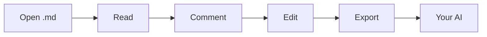

# Welcome to mdeverything ✨

**Read, comment and edit Markdown — then hand it to your AI.** mdeverything is a quiet, fast review desk for any `.md` file: point at the exact words that matter, say what you want, and export a package your assistant can act on without guessing.

> 👋 **This page is a live document.** Hover a highlighted phrase to peek at an example comment, click it to open the thread, or select any sentence below and press **Enter** to add your own. Nothing you do here leaves your browser.

## 1. Why mdeverything?

Most AI reviews start the same way: you copy-paste a few paragraphs into a chatbot, type "can you improve this?", and get back a rewrite of the wrong section. The model never saw the whole document, and it can't tell which sentence you meant.

mdeverything fixes the handoff:

- **Precise** — every comment is pinned to a quoted passage, its section and the text around it, so repeated wording is never confused.
- **Complete** — export the full document together with every comment and reply, in one copy.
- **Fast** — no sign-up, no upload, no plug-ins. Open a file and start reviewing in seconds.
- **Calm** — a distraction-free reading view with an outline, three themes and typography made for long specs.

## 2. How it works

1. **Open** a Markdown file, drop it on the page, or paste the text.
2. **Comment** on the words that matter — select a passage, or use the margin button to cover a whole paragraph.
3. **Refine** the source in the built-in editor when you spot a typo; your comments re-anchor automatically.
4. **Export for AI** and paste the bundle into ChatGPT, Claude, Gemini or your coding assistant.



Curious what the export looks like? Hover or click [What your AI receives](#31-what-your-ai-receives) to peek at it.

### 2.1 Ask, answer, accept

Turn on **Let AI reply back into mdeverything** in the Export menu and your assistant answers in a format this page understands. Paste its reply with **Paste AI answer…**: each answer lands under its comment, and every suggested edit shows as a diff you can accept or reject. Accepting rewrites the Markdown for you, and Undo is always one click away.

## 3. Features at a glance

| Feature | What you get | How |
| --- | --- | --- |
| Inline comments | Comment right on the selected words, with reply threads | Select text, press `Enter` |
| Margin comments | One click to comment on a whole paragraph, heading or table cell | Hover a block, use the left margin |
| Outline | A table of contents that follows your reading position | `☰` in the top bar |
| Markdown editor | Formatting toolbar, shortcuts and a live preview | `✎ Edit`, then `Ctrl + Enter` to apply |
| Reading themes | Paper, Sepia (cream paper with a bookish serif) and Night | Theme switch in the top bar |
| Autosave | Your document and comments are still here when you come back | Automatic |
| AI answers in place | Paste the AI's reply back: each answer lands under its comment, edits shown as old → new | **Paste AI answer** in the Export menu |
| Follow-up rounds | Export again and only new and follow-up comments get answered | Automatic |

### 3.1 What your AI receives

Every export starts with clear instructions, then the document, then one block per comment:

```text
[1] Location: section “Pricing” · line ~42
Quoted passage:
"""
Free for teams of up to 5 people
"""
Context: …Our plans start simple: 〈Free for teams of up to 5 people〉, then $8 per seat…
Note / question:
"""
Is 5 still the right limit? Check it against the FAQ section.
"""
Replies (1):
- Also confirm the per-seat price in the table below.
```

The assistant knows exactly **where** to look and **what** you want — so it answers the question you asked, in the place you asked it.

## 4. Made for real documents

- 📐 **Product specs** — PRDs, BRDs and user requirements with wide tables and flow diagrams.
- 💻 **Technical docs** — READMEs, API guides and runbooks with code blocks you can copy in one click.
- 🧪 **Research & analysis** — long notes where every claim needs a second look.
- ✍️ **Drafts** — blog posts, proposals and release notes before they ship.

It works in any language — English, Tiếng Việt, 日本語 — because comments anchor to the exact words, not to line numbers.

Already handled for you:

- [x] Wide tables scroll sideways instead of breaking words
- [x] Mermaid diagrams render right in the page
- [x] Code blocks get a language label and a copy button
- [ ] Your own document is next

## 5. Private by design

> **No account. No upload. No tracking.** mdeverything runs entirely in your browser, and your work is saved locally on this device. Close the tab, come back tomorrow, and pick up where you left off.

## 6. Try it now

1. Select any sentence on this page and press **Enter** to leave a comment.
2. Click a highlight, then write a **Reply** to start a thread.
3. Press **Export for AI** in the top bar and paste the result into your favourite assistant.

Ready for your own file? Use **Open** in the top bar, or drop a `.md` file anywhere on this page. 🚀
