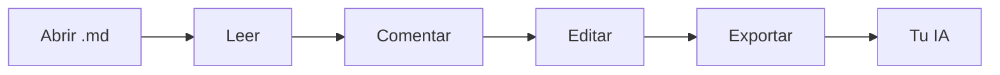

# Bienvenido a mdeverything ✨

**Lee, comenta y edita Markdown — y luego pásaselo a tu IA.** mdeverything es una mesa de revisión tranquila y rápida para cualquier archivo `.md`: señala las palabras exactas que importan, di lo que quieres y exporta un paquete con el que tu asistente pueda trabajar sin adivinar.

> 👋 **Esta página es un documento en vivo.** Pasa el cursor sobre una frase resaltada para ver un comentario de ejemplo, haz clic para abrir el hilo, o selecciona cualquier oración de abajo y presiona **Enter** para agregar el tuyo. Nada de lo que hagas aquí sale de tu navegador.

## 1. ¿Por qué mdeverything?

Casi todas las revisiones con IA empiezan igual: copias y pegas unos párrafos en un chatbot, escribes "¿puedes mejorar esto?" y recibes una reescritura de la sección equivocada. El modelo nunca vio el documento completo y no sabe a qué oración te referías.

mdeverything resuelve ese traspaso:

- **Preciso** — cada comentario queda fijado a un pasaje citado, a su sección y al texto de alrededor, así las frases repetidas nunca se confunden.
- **Completo** — exporta el documento entero junto con cada comentario y respuesta, en una sola copia.
- **Rápido** — sin registro, sin subidas, sin extensiones. Abre un archivo y empieza a revisar en segundos.
- **Tranquilo** — una vista de lectura sin distracciones, con índice, tres temas y una tipografía pensada para especificaciones largas.

## 2. Cómo funciona

1. **Abre** un archivo Markdown, suéltalo en la página o pega el texto.
2. **Comenta** las palabras que importan: selecciona un pasaje o usa el botón del margen para abarcar un párrafo entero.
3. **Corrige** el texto fuente en el editor integrado cuando veas una errata; tus comentarios se vuelven a anclar solos.
4. **Exporta para IA** y pega el paquete en ChatGPT, Claude, Gemini o tu asistente de programación.



¿Quieres ver cómo es la exportación? Pasa el cursor o haz clic en [Lo que recibe tu IA](#31-lo-que-recibe-tu-ia) para echarle un vistazo.

### 2.1 Pregunta, responde, acepta

Activa **Que la IA responda dentro de mdeverything** en el menú Exportar y tu asistente responderá en un formato que esta página entiende. Pega su respuesta con **Pegar respuesta de la IA…**: cada respuesta aparece bajo su comentario, y cada edición sugerida se muestra como un diff que puedes aceptar o rechazar. Al aceptar, el Markdown se reescribe por ti, y Deshacer siempre está a un clic.

## 3. Funciones de un vistazo

| Función | Qué obtienes | Cómo |
| --- | --- | --- |
| Comentarios en línea | Comenta justo sobre las palabras seleccionadas, con hilos de respuestas | Selecciona texto, presiona `Enter` |
| Comentarios en el margen | Un clic para comentar un párrafo, título o celda de tabla completos | Pasa el cursor sobre un bloque, usa el margen izquierdo |
| Índice | Una tabla de contenido que sigue tu posición de lectura | `☰` en la barra superior |
| Editor Markdown | Barra de formato, atajos y vista previa en vivo | `✎ Editar`, luego `Ctrl + Enter` para aplicar |
| Temas de lectura | Papel, Sepia (papel crema con una serif de libro) y Noche | Selector de tema en la barra superior |
| Guardado automático | Tu documento y tus comentarios siguen aquí cuando vuelves | Automático |
| Respuestas de la IA en su lugar | Pega de vuelta la respuesta de la IA: cada una aparece bajo su comentario, con las ediciones como antes → después | **Pegar respuesta de la IA** en el menú Exportar |
| Rondas de seguimiento | Exporta de nuevo y solo se responden los comentarios nuevos y de seguimiento | Automático |

### 3.1 Lo que recibe tu IA

Cada exportación empieza con instrucciones claras, luego el documento y después un bloque por comentario:

```text
[1] Ubicación: sección “Precios” · línea ~42
Pasaje citado:
"""
Gratis para equipos de hasta 5 personas
"""
Contexto: …Nuestros planes empiezan simple: 〈Gratis para equipos de hasta 5 personas〉, luego $8 por usuario…
Nota / pregunta:
"""
¿Sigue siendo 5 el límite correcto? Compáralo con la sección de preguntas frecuentes.
"""
Respuestas (1):
- Confirma también el precio por usuario en la tabla de abajo.
```

El asistente sabe exactamente **dónde** mirar y **qué** quieres, así que responde la pregunta que hiciste, en el lugar donde la hiciste.

## 4. Hecho para documentos reales

- 📐 **Especificaciones de producto** — PRD, BRD y requisitos de usuario con tablas anchas y diagramas de flujo.
- 💻 **Documentación técnica** — README, guías de API y runbooks con bloques de código que copias en un clic.
- 🧪 **Investigación y análisis** — notas largas donde cada afirmación merece una segunda mirada.
- ✍️ **Borradores** — artículos de blog, propuestas y notas de versión antes de publicarse.

Funciona en cualquier idioma — español, English, Tiếng Việt, 日本語 — porque los comentarios se anclan a las palabras exactas, no a números de línea.

Ya resuelto para ti:

- [x] Las tablas anchas se desplazan de lado en vez de cortar palabras
- [x] Los diagramas Mermaid se muestran directamente en la página
- [x] Los bloques de código tienen etiqueta de lenguaje y botón de copiar
- [ ] Ahora le toca a tu propio documento

## 5. Privado por diseño

> **Sin cuenta. Sin subidas. Sin rastreo.** mdeverything funciona por completo en tu navegador, y tu trabajo se guarda localmente en este dispositivo. Cierra la pestaña, vuelve mañana y sigue donde lo dejaste.

## 6. Pruébalo ahora

1. Selecciona cualquier oración de esta página y presiona **Enter** para dejar un comentario.
2. Haz clic en un resaltado y escribe una **Respuesta** para iniciar un hilo.
3. Presiona **Exportar para IA** en la barra superior y pega el resultado en tu asistente favorito.

¿Listo para tu propio archivo? Usa **Abrir** en la barra superior o suelta un archivo `.md` en cualquier parte de esta página. 🚀
