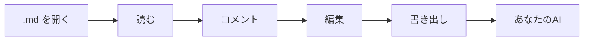

# mdeverything へようこそ ✨

**Markdownを読み、コメントし、編集して、そのままAIに渡せます。** mdeverything は、どんな `.md` ファイルにも使える静かで軽快なレビューデスクです。大事な言葉をピンポイントで指し示し、してほしいことを書けば、アシスタントが推測せずに動けるパッケージとして書き出せます。

> 👋 **このページは実際に動く文書です。** ハイライトされた語句にカーソルを合わせるとコメントの例が表示され、クリックするとスレッドが開きます。下の好きな文を選択して **Enter** を押せば、自分のコメントも追加できます。ここでの操作がブラウザの外に出ることはありません。

## 1. なぜ mdeverything なのか？

AIによるレビューは、たいてい同じように始まります。数段落をコピーしてチャットボットに貼り付け、「これを改善して」と入力すると、違うセクションの書き直しが返ってくる。モデルは文書全体を見ておらず、どの文のことなのかも分かりません。

mdeverything はこの受け渡しを解決します。

- **正確** — すべてのコメントが引用箇所、そのセクション、前後の文章に結び付くので、同じ言い回しが繰り返されても取り違えることはありません。
- **完全** — 文書全体を、すべてのコメントと返信と一緒に一度でコピーできます。
- **速い** — 登録もアップロードもプラグインも不要。ファイルを開けば数秒でレビューを始められます。
- **落ち着く** — アウトライン、3つのテーマ、長い仕様書のための文字組みを備えた、集中できる閲覧画面。

## 2. 使い方

1. Markdownファイルを**開く**か、ページにドロップするか、テキストを貼り付けます。
2. 大事な言葉に**コメント**します。箇所を選択するか、余白のボタンで段落全体を対象にできます。
3. 誤字を見つけたら、内蔵エディターでソースを**修正**します。コメントは自動で位置を合わせ直します。
4. **AI用に書き出し**て、ChatGPT、Claude、Gemini やコーディングアシスタントに貼り付けます。



書き出しの中身が気になりますか？ [AIが受け取る内容](#31-aiが受け取る内容) にカーソルを合わせるかクリックすると、のぞいてみられます。

### 2.1 質問し、回答を受け取り、承認する

書き出しメニューで **AIの回答をmdeverythingに戻す** をオンにすると、アシスタントはこのページが理解できる形式で回答します。その返答を **AIの回答を貼り付け…** で貼り付けると、各回答がそれぞれのコメントの下に入り、それぞれの修正案は差分として表示され、承認または却下できます。承認するとMarkdownが書き換わり、元に戻すのもワンクリックです。

## 3. 機能一覧

| 機能 | できること | 操作 |
| --- | --- | --- |
| インラインコメント | 選択した言葉に直接コメントし、返信でスレッドにできる | テキストを選択して `Enter` |
| 余白コメント | 段落・見出し・表のセルにワンクリックでコメント | ブロックにカーソルを合わせ、左の余白を使う |
| アウトライン | 読んでいる位置に追従する目次 | 上部バーの `☰` |
| Markdownエディター | 書式ツールバー、ショートカット、ライブプレビュー | `✎ 編集` を押し、`Ctrl + Enter` で適用 |
| 閲覧テーマ | ペーパー、セピア（本のようなセリフ体とクリーム色の紙）、ナイト | 上部バーのテーマ切り替え |
| 自動保存 | 戻ってきても文書とコメントはそのまま | 自動 |
| AIの回答をその場に | AIの返答を貼り戻すと、各回答がコメントの下に入り、修正は 修正前 → 修正後 で表示 | 書き出しメニューの **AIの回答を貼り付け** |
| 追加の往復 | 再度書き出すと、新しいコメントと追加の質問にだけ回答が返る | 自動 |

### 3.1 AIが受け取る内容

書き出しは、まず明確な指示、次に文書、そしてコメントごとに1つのブロックという構成です。

```text
[1] 場所: セクション「料金」 · 約 42 行目
引用箇所:
"""
5人までのチームは無料
"""
文脈: …料金プランはシンプルです。〈5人までのチームは無料〉、それ以降は1席あたり8ドル…
メモ / 質問:
"""
上限は今も5人で正しいですか？FAQセクションと照らし合わせてください。
"""
返信（1）:
- 下の表の1席あたりの価格も確認してください。
```

アシスタントは**どこを**見て**何を**すればよいかを正確に把握できるので、尋ねた質問に、尋ねた場所で答えてくれます。

## 4. 実際の文書のために

- 📐 **製品仕様** — 横に広い表やフロー図を含むPRD、BRD、ユーザー要件。
- 💻 **技術文書** — ワンクリックでコピーできるコードブロック付きのREADME、APIガイド、運用手順書。
- 🧪 **調査・分析** — すべての主張を見直す必要がある長いメモ。
- ✍️ **下書き** — 公開前のブログ記事、提案書、リリースノート。

コメントは行番号ではなく言葉そのものに結び付くので、English、Tiếng Việt、日本語など、どの言語でも使えます。

すでに対応済み:

- [x] 横に広い表は単語を崩さず横スクロール
- [x] Mermaid図をページ内でそのまま表示
- [x] コードブロックに言語ラベルとコピーボタン
- [ ] 次はあなたの文書です

## 5. 設計からプライベート

> **アカウントなし。アップロードなし。トラッキングなし。** mdeverything はすべてブラウザ内で動作し、作業内容はこの端末にローカル保存されます。タブを閉じても、明日戻ってくれば続きから再開できます。

## 6. 今すぐ試す

1. このページの好きな文を選択し、**Enter** を押してコメントを残します。
2. ハイライトをクリックし、**返信** を書いてスレッドを始めます。
3. 上部バーの **AI用に書き出す** を押し、結果をお気に入りのアシスタントに貼り付けます。

自分のファイルで試しますか？ 上部バーの **インポート** を使うか、`.md` ファイルをこのページのどこにでもドロップしてください。🚀
