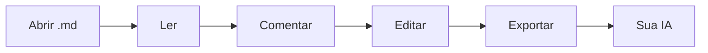

# Boas-vindas ao mdeverything ✨

**Leia, comente e edite Markdown — e depois entregue para a sua IA.** O mdeverything é uma mesa de revisão tranquila e rápida para qualquer arquivo `.md`: aponte as palavras exatas que importam, diga o que você quer e exporte um pacote que o seu assistente consegue usar sem adivinhar.

> 👋 **Esta página é um documento de verdade.** Passe o mouse sobre um trecho destacado para ver um comentário de exemplo, clique para abrir a conversa ou selecione qualquer frase abaixo e pressione **Enter** para adicionar o seu. Nada do que você faz aqui sai do seu navegador.

## 1. Por que o mdeverything?

A maioria das revisões com IA começa do mesmo jeito: você copia e cola alguns parágrafos num chatbot, digita "dá para melhorar isto?" e recebe de volta a reescrita da seção errada. O modelo nunca viu o documento inteiro e não sabe de qual frase você estava falando.

O mdeverything resolve essa passagem de bastão:

- **Preciso** — cada comentário fica preso a um trecho citado, à sua seção e ao texto ao redor, então frases repetidas nunca se confundem.
- **Completo** — exporte o documento inteiro junto com todos os comentários e respostas, numa única cópia.
- **Rápido** — sem cadastro, sem upload, sem plug-ins. Abra um arquivo e comece a revisar em segundos.
- **Tranquilo** — uma leitura sem distrações, com sumário, três temas e tipografia pensada para especificações longas.

## 2. Como funciona

1. **Abra** um arquivo Markdown, solte-o na página ou cole o texto.
2. **Comente** as palavras que importam — selecione um trecho ou use o botão da margem para comentar um parágrafo inteiro.
3. **Ajuste** o código-fonte no editor embutido quando achar um erro de digitação; seus comentários se reancoram automaticamente.
4. **Exporte para a IA** e cole o pacote no ChatGPT, Claude, Gemini ou no seu assistente de programação.



Quer saber como fica a exportação? Passe o mouse ou clique em [O que a sua IA recebe](#31-o-que-a-sua-ia-recebe) para dar uma olhada.

### 2.1 Pergunte, receba a resposta, aceite

Ative **Deixar a IA responder no mdeverything** no menu Exportar e o seu assistente responde num formato que esta página entende. Cole a resposta com **Colar resposta da IA…**: cada resposta aparece sob o próprio comentário, e cada edição sugerida aparece como um diff que você pode aceitar ou rejeitar. Ao aceitar, o Markdown é reescrito para você, e o Desfazer está sempre a um clique.

## 3. Recursos num relance

| Recurso | O que você ganha | Como |
| --- | --- | --- |
| Comentários no texto | Comente direto nas palavras selecionadas, com conversas de respostas | Selecione o texto, pressione `Enter` |
| Comentários na margem | Um clique para comentar um parágrafo, título ou célula de tabela inteiros | Passe o mouse sobre um bloco, use a margem esquerda |
| Sumário | Um índice que acompanha a sua posição de leitura | `☰` na barra superior |
| Editor de Markdown | Barra de formatação, atalhos e prévia ao vivo | `✎ Editar`, depois `Ctrl + Enter` para aplicar |
| Temas de leitura | Papel, Sépia (papel creme com uma serifa de livro) e Noite | Seletor de tema na barra superior |
| Salvamento automático | Seu documento e seus comentários continuam aqui quando você volta | Automático |
| Respostas da IA no lugar | Cole a resposta da IA de volta: cada resposta aparece sob o seu comentário, com as edições como antigo → novo | **Colar resposta da IA** no menu Exportar |
| Rodadas de acompanhamento | Exporte de novo e só os comentários novos e de acompanhamento são respondidos | Automático |

### 3.1 O que a sua IA recebe

Toda exportação começa com instruções claras, depois o documento e então um bloco por comentário:

```text
[1] Local: seção “Preços” · linha ~42
Trecho citado:
"""
Grátis para equipes de até 5 pessoas
"""
Contexto: …Nossos planos começam simples: 〈Grátis para equipes de até 5 pessoas〉, depois US$ 8 por usuário…
Nota / pergunta:
"""
5 ainda é o limite certo? Confira com a seção de perguntas frequentes.
"""
Respostas (1):
- Confirme também o preço por usuário na tabela abaixo.
```

O assistente sabe exatamente **onde** olhar e **o que** você quer — então responde à pergunta que você fez, no lugar em que você fez.

## 4. Feito para documentos reais

- 📐 **Especificações de produto** — PRDs, BRDs e requisitos de usuário com tabelas largas e diagramas de fluxo.
- 💻 **Documentação técnica** — READMEs, guias de API e runbooks com blocos de código que você copia num clique.
- 🧪 **Pesquisa e análise** — notas longas em que cada afirmação merece uma segunda olhada.
- ✍️ **Rascunhos** — posts de blog, propostas e notas de versão antes de serem publicados.

Funciona em qualquer idioma — English, Português, 日本語 — porque os comentários se prendem às palavras exatas, não a números de linha.

Já resolvido para você:

- [x] Tabelas largas rolam para o lado em vez de quebrar palavras
- [x] Diagramas Mermaid são renderizados direto na página
- [x] Blocos de código ganham um rótulo de linguagem e um botão de copiar
- [ ] Agora é a vez do seu documento

## 5. Privado por padrão

> **Sem conta. Sem upload. Sem rastreamento.** O mdeverything roda inteiramente no seu navegador, e seu trabalho fica salvo localmente neste dispositivo. Feche a aba, volte amanhã e continue de onde parou.

## 6. Experimente agora

1. Selecione qualquer frase desta página e pressione **Enter** para deixar um comentário.
2. Clique num destaque e escreva uma **Resposta** para iniciar uma conversa.
3. Pressione **Exportar para IA** na barra superior e cole o resultado no seu assistente favorito.

Pronto para o seu próprio arquivo? Use **Importar** na barra superior ou solte um arquivo `.md` em qualquer lugar desta página. 🚀
