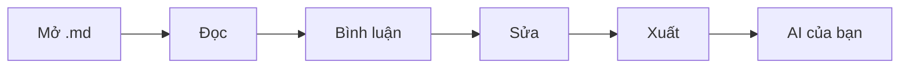

# Chào mừng đến với mdeverything ✨

**Đọc, bình luận và sửa Markdown — rồi giao cho AI của bạn.** mdeverything là một bàn review yên tĩnh, nhanh gọn cho mọi file `.md`: chỉ vào đúng những chữ quan trọng, nói điều bạn muốn, rồi xuất ra một gói mà trợ lý của bạn có thể làm theo mà không phải đoán.

> 👋 **Trang này là một tài liệu thật.** Di chuột lên một cụm từ được tô sáng để xem nhanh bình luận ví dụ, bấm vào để mở luồng thảo luận, hoặc chọn một câu bất kỳ bên dưới và nhấn **Enter** để thêm bình luận của riêng bạn. Mọi thứ bạn làm ở đây đều không rời khỏi trình duyệt.

## 1. Vì sao chọn mdeverything?

Hầu hết các lần nhờ AI review đều bắt đầu giống nhau: bạn sao chép vài đoạn văn rồi dán vào chatbot, gõ "bạn cải thiện giúp mình được không?", và nhận lại bản viết lại của sai phần. Mô hình chưa từng thấy toàn bộ tài liệu, và nó không biết bạn đang nói tới câu nào.

mdeverything giải quyết khâu bàn giao đó:

- **Chính xác** — mỗi bình luận được gắn với một đoạn trích dẫn, mục chứa nó và phần văn bản xung quanh, nên những câu chữ lặp lại không bao giờ bị nhầm lẫn.
- **Đầy đủ** — xuất toàn bộ tài liệu cùng mọi bình luận và phản hồi, chỉ trong một lần sao chép.
- **Nhanh** — không đăng ký, không tải lên, không cần plug-in. Mở file và bắt đầu review trong vài giây.
- **Thư thái** — giao diện đọc không xao nhãng, có mục lục, ba giao diện màu và kiểu chữ phù hợp cho những bản đặc tả dài.

## 2. Cách hoạt động

1. **Mở** một file Markdown, thả nó vào trang, hoặc dán văn bản.
2. **Bình luận** vào những chữ quan trọng — chọn một đoạn, hoặc dùng nút ở lề để bình luận cả một đoạn văn.
3. **Chỉnh sửa** mã nguồn trong trình soạn có sẵn khi bạn thấy lỗi chính tả; bình luận của bạn sẽ tự động bám lại đúng chỗ.
4. **Xuất cho AI** và dán gói đó vào ChatGPT, Claude, Gemini hoặc trợ lý lập trình của bạn.



Tò mò bản xuất trông như thế nào? Di chuột hoặc bấm vào [AI của bạn nhận được gì](#31-ai-của-bạn-nhận-được-gì) để xem nhanh.

### 2.1 Hỏi, trả lời, chấp nhận

Bật **Cho AI trả lời ngược vào mdeverything** trong menu Xuất và trợ lý sẽ trả lời theo định dạng mà trang này hiểu được. Dán câu trả lời bằng **Dán câu trả lời của AI…**: mỗi câu trả lời nằm ngay dưới bình luận của nó, và mỗi đề xuất sửa hiện thành một diff để bạn chấp nhận hoặc từ chối. Khi chấp nhận, Markdown được viết lại giúp bạn, và Hoàn tác luôn chỉ cách một cú bấm.

## 3. Tính năng nổi bật

| Tính năng | Bạn nhận được gì | Cách dùng |
| --- | --- | --- |
| Bình luận trên dòng | Bình luận ngay trên những chữ đã chọn, kèm luồng phản hồi | Chọn văn bản, nhấn `Enter` |
| Bình luận ở lề | Một cú bấm để bình luận cả đoạn văn, tiêu đề hoặc ô bảng | Di chuột lên một khối, dùng lề trái |
| Mục lục | Mục lục đi theo vị trí bạn đang đọc | `☰` trên thanh trên cùng |
| Trình soạn Markdown | Thanh định dạng, phím tắt và xem trước trực tiếp | `✎ Sửa`, rồi `Ctrl + Enter` để áp dụng |
| Giao diện đọc | Giấy, Sepia (giấy màu kem với font serif như sách) và Đêm | Nút Giao diện trên thanh trên cùng |
| Tự động lưu | Tài liệu và bình luận vẫn còn nguyên khi bạn quay lại | Tự động |
| Câu trả lời AI tại chỗ | Dán câu trả lời của AI trở lại: mỗi câu trả lời nằm dưới bình luận của nó, chỗ sửa hiển thị dạng cũ → mới | **Dán câu trả lời của AI** trong menu Xuất |
| Các vòng tiếp nối | Xuất lại và AI chỉ trả lời các bình luận mới và tiếp nối | Tự động |

### 3.1 AI của bạn nhận được gì

Mỗi bản xuất bắt đầu bằng hướng dẫn rõ ràng, tiếp theo là tài liệu, rồi mỗi bình luận một khối:

```text
[1] Vị trí: mục “Bảng giá” · dòng ~42
Đoạn trích dẫn:
"""
Miễn phí cho nhóm tối đa 5 người
"""
Ngữ cảnh: …Các gói của chúng tôi bắt đầu đơn giản: 〈Miễn phí cho nhóm tối đa 5 người〉, sau đó $8 mỗi người dùng…
Ghi chú / câu hỏi:
"""
Giới hạn 5 người còn hợp lý không? Đối chiếu với mục Câu hỏi thường gặp.
"""
Phản hồi (1):
- Kiểm tra luôn giá mỗi người dùng trong bảng bên dưới.
```

Trợ lý biết chính xác cần nhìn vào **đâu** và bạn muốn **gì** — nên nó trả lời đúng câu bạn hỏi, ở đúng chỗ bạn hỏi.

## 4. Dành cho tài liệu thật

- 📐 **Đặc tả sản phẩm** — PRD, BRD và yêu cầu người dùng với bảng rộng và sơ đồ luồng.
- 💻 **Tài liệu kỹ thuật** — README, hướng dẫn API và runbook với các khối code sao chép chỉ bằng một cú bấm.
- 🧪 **Nghiên cứu & phân tích** — những ghi chép dài mà nhận định nào cũng cần xem lại lần nữa.
- ✍️ **Bản nháp** — bài blog, đề xuất và ghi chú phát hành trước khi công bố.

Nó dùng được với mọi ngôn ngữ — English, Tiếng Việt, 日本語 — vì bình luận bám vào đúng từng chữ, chứ không phải số dòng.

Những việc đã lo sẵn cho bạn:

- [x] Bảng rộng cuộn ngang thay vì làm gãy chữ
- [x] Sơ đồ Mermaid hiển thị ngay trong trang
- [x] Khối code có nhãn ngôn ngữ và nút sao chép
- [ ] Tiếp theo là tài liệu của chính bạn

## 5. Riêng tư từ thiết kế

> **Không tài khoản. Không tải lên. Không theo dõi.** mdeverything chạy hoàn toàn trong trình duyệt của bạn, và dữ liệu được lưu cục bộ trên thiết bị này. Đóng tab, mai quay lại, và tiếp tục từ chỗ bạn đã dừng.

## 6. Thử ngay

1. Chọn một câu bất kỳ trên trang này và nhấn **Enter** để bình luận.
2. Bấm vào một phần tô sáng, rồi viết **Phản hồi** để bắt đầu một luồng thảo luận.
3. Nhấn **Xuất cho AI** trên thanh trên cùng và dán kết quả vào trợ lý bạn yêu thích.

Sẵn sàng với file của riêng bạn? Dùng **Mở** trên thanh trên cùng, hoặc thả một file `.md` vào bất kỳ đâu trên trang này. 🚀
